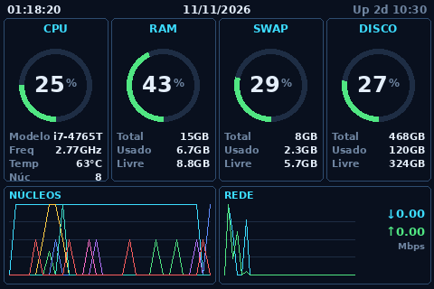
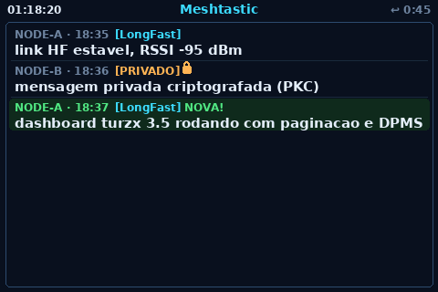

# Turzx 3.5" Dashboard

> 📖 **Read this in:** [English](README.md) · [Português](README.pt-BR.md)

Python dashboard for **Turzx / Turing "USB Monitor" 3.5″ mini LCDs** (WCH **CH572**,
USB VID:PID `1a86:5722`). It turns one of these tiny USB-CDC screens into a live
**system monitor** with a second **Meshtastic** message page, and it can **follow the
host monitor's power state** (sleep when the display sleeps, wake when it wakes).




## What it is

A small set of scripts that push full RGB565 frames to the display over its serial
port. No vendor Windows software needed — it talks the open
[Turing Smart Screen protocol](https://github.com/mathoudebine/turing-smart-screen-python)
directly.

**Features**

- 🖥️ Multiple layouts: a clock, an AIDA64-style panel grid, and a dense "neon grid"
  system monitor (CPU / RAM / SWAP / DISK gauges + per-core and network graphs).
- 💬 A **Meshtastic** page that appears automatically when a message arrives and
  returns to the system page after 60 s (timer resets on each new message).
- 🔒 Per-message channel/private labels and a padlock shown **only** when a message
  is genuinely encrypted.
- 🌙 **DPMS mirroring**: the little screen turns off when the main monitor sleeps.
- ♻️ Robust: auto-reconnect on unplug/replug, "zombie tty" detection, autostart via
  a systemd user service, stable `/dev` symlink via udev.

## Hardware

| Item | Value |
|------|-------|
| Screen | Turzx / Turing 3.5″ USB monitor (85 × 55 × 8 mm) |
| Controller | WCH CH572 (USB-CDC) |
| USB ID | `1a86:5722` (QinHeng/WCH) |
| Native panel | 320 × 480 (portrait) — used as **480 × 320** landscape |
| Link | serial `115200 8N1`, pixel format RGB565 little-endian |

## Prerequisites

- Linux with Python **3.9+**.
- The display plugged into USB.
- Permission to read/write the serial port (group `dialout`).
- For the Meshtastic page: a Meshtastic node + the [`meshtastic`](https://pypi.org/project/meshtastic/) library on the machine that owns the radio.
- For DPMS mirroring: a KDE/GNOME session exposing `org.freedesktop.ScreenSaver` (Wayland) or `xset` (X11).

## Install

```bash
git clone <this-repo-url> turzx-dashboard
cd turzx-dashboard
python3 -m venv .venv
source .venv/bin/activate
pip install -r requirements.txt
```

## Identify the device

```bash
lsusb | grep 1a86:5722          # confirm it is detected
ls /dev/ttyACM*                 # the display is usually /dev/ttyACM0
```

Give your user serial access (log out/in after):

```bash
sudo usermod -aG dialout "$USER"
```

## Run a layout

Every layout auto-detects the screen; pass `--port` to force one.

```bash
python dashboard.py         # clock + CPU/RAM/SWAP/DISK bars
python dashboard_mod.py     # layout 01 — AIDA64-style panels
python dashboard_grid.py    # layout 02 — dense "neon grid" (system page)
python dashboard_pages.py   # paginated: system page + Meshtastic page + DPMS
```

Common flags (all layouts): `--port /dev/ttyACM0`, `--interval 1`, `--brightness 80`.
`dashboard_pages.py` also accepts `--inbox <path>` and `--no-dpms`.

> **Upside-down screen?** These CH572 clones **ignore** the hardware orientation
> command, so the driver rotates in software (`rotate=180`) before sending. That is
> the default; no action needed.

## Stable device name (udev) — recommended

Without this, the display may grab a different `/dev/ttyACMx` after a reboot or when
another USB-serial device is present.

```bash
sudo cp udev/99-turzx.rules /etc/udev/rules.d/
sudo udevadm control --reload && sudo udevadm trigger
ls -l /dev/ttyCH572          # stable symlink -> the display
```

## Autostart (systemd user service)

```bash
# 1) edit systemd/turzx-dashboard.service: replace YOURUSER with your username
mkdir -p ~/.config/systemd/user
cp systemd/turzx-dashboard.service ~/.config/systemd/user/
nano ~/.config/systemd/user/turzx-dashboard.service   # fix the paths

# 2) enable (runs at login, restarts on failure)
systemctl --user daemon-reload
systemctl --user enable --now turzx-dashboard

# 3) start at boot even before login, and allow udev to restart it
sudo loginctl enable-linger "$USER"
```

Logs: `journalctl --user -u turzx-dashboard -f`

## Meshtastic page

The radio's serial port is **exclusive** — only one process can hold it. So the
dashboard does **not** open the radio; it reads a small **inbox file** that a
Meshtastic process appends to.

1. On the machine that owns the radio, run the example writer (or wire the same
   `registrar()` call into your own bot):

   ```bash
   pip install meshtastic
   MESHBOT_INBOX=~/turzx-dashboard/mesh_inbox.jsonl \
       python examples/meshtastic_inbox_example.py
   ```

2. Point the dashboard at the same file:

   ```bash
   MESHBOT_INBOX=~/turzx-dashboard/mesh_inbox.jsonl python dashboard_pages.py
   ```

Each line is one JSON message:

```json
{"ts": 1730000000, "hora": "18:35", "de": "NODE-A", "canal": "LongFast",
 "privado": false, "cripto": false, "texto": "link estavel"}
```

**Behaviour:** the system page is always shown; a new inbox line switches to the
Meshtastic page for 60 s (reset on every new message), then returns. The newest
message is highlighted with a green background and a **NOVA!** tag.

**Padlock rule (private ≠ encrypted):** a padlock is drawn only when the message is
really encrypted — a public-key PM (`pki_encrypted`) or a channel whose PSK is a
custom key. The default `LongFast` key and unencrypted channels show **no** padlock.

## DPMS mirroring (screen sleeps with the monitor)

`dashboard_pages.py` polls the desktop's screen-saver state every ~3 s and mirrors it:

- **Wayland / KDE:** `org.freedesktop.ScreenSaver.GetActive` (via `busctl --user`).
- **X11:** `xset -q` ("Monitor is Off/Standby/Suspend").

When the monitor sleeps, the little screen gets `SCREEN_OFF`; when it wakes,
`SCREEN_ON`. If the query fails it stays on (never blanks by accident). Disable with
`--no-dpms`.

> The user service reaches the session D-Bus with only `XDG_RUNTIME_DIR` set
> (systemd provides it). Quick check:
> `env -i XDG_RUNTIME_DIR=/run/user/$(id -u) busctl --user call org.freedesktop.ScreenSaver /ScreenSaver org.freedesktop.ScreenSaver GetActive`

## Files

| File | Purpose |
|------|---------|
| `tscreen.py` | Serial driver (RGB565 frames, brightness, on/off, reconnect, zombie-tty guard) |
| `dashboard.py` | Layout: clock + bars |
| `dashboard_mod.py` | Layout 01 — panel grid |
| `dashboard_grid.py` | Layout 02 — "neon grid" system monitor |
| `dashboard_pages.py` | Paginated dashboard (system + Meshtastic + DPMS) |
| `examples/meshtastic_inbox_example.py` | Writes received Meshtastic messages to the inbox |
| `udev/99-turzx.rules` | Stable `/dev/ttyCH572` symlink (+ optional hotplug restart) |
| `systemd/turzx-dashboard.service` | Autostart unit template |

## Troubleshooting

- **Screen dark after moving the cable:** run `lsusb | grep 1a86` first. If the device
  is gone from `lsusb` and there is no kernel connect event, it is physical (cable/port).
- **Screen dark but process healthy ("zombie tty"):** if the USB device re-enumerates
  while the port is held, writes can silently go nowhere. The driver records the USB
  `devnum` and re-checks it every frame to force a reconnect. Interim fix: replug.
- **`PermissionError` on the port:** add yourself to `dialout` and re-login, or check
  the udev `MODE`/`GROUP`.
- **Two processes, one port:** the Meshtastic writer and any other tool cannot share
  the radio serial. Only the dashboard reads the inbox file.

## Credits & license

Protocol reverse-engineered by the
[turing-smart-screen-python](https://github.com/mathoudebine/turing-smart-screen-python)
project. This code is MIT-licensed (see [LICENSE](LICENSE)).
