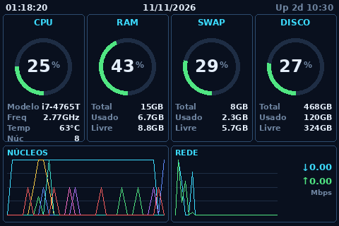
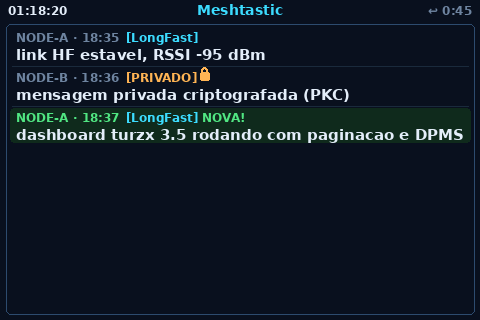

# Turzx 3.5" Dashboard

> 📖 **Idiomas:** [English](README.md) · [Português](README.pt-BR.md)

Dashboard em Python para **mini telas USB Turzx / Turing "USB Monitor" de 3,5″**
(WCH **CH572**, USB VID:PID `1a86:5722`). Transforma uma dessas telinhas USB-CDC em um
**monitor de sistema** ao vivo, com uma segunda página de mensagens **Meshtastic**, e
pode **acompanhar o estado de energia do monitor principal** (apaga quando o monitor
entra em descanso, religa quando ele acorda).




## O que é

Um conjunto de scripts que envia quadros completos em RGB565 para a tela pela porta
serial. Não precisa do software Windows do fabricante — fala diretamente o protocolo
aberto do [Turing Smart Screen](https://github.com/mathoudebine/turing-smart-screen-python).

**Recursos**

- 🖥️ Vários layouts: relógio, grade de painéis estilo AIDA64 e um monitor denso
  "grid neon" (gauges de CPU / RAM / SWAP / DISCO + gráficos de núcleos e de rede).
- 💬 Página **Meshtastic** que aparece sozinha quando chega mensagem e volta à página
  de sistema após 60 s (o contador reinicia a cada mensagem nova).
- 🔒 Rótulos de canal/privado por mensagem e cadeado exibido **somente** quando a
  mensagem é realmente criptografada.
- 🌙 **Espelhamento de DPMS:** a telinha apaga quando o monitor principal dorme.
- ♻️ Robusto: reconexão automática ao plugar/plugar, detecção de "tty zumbi",
  inicialização automática via serviço de usuário do systemd e symlink `/dev` estável via udev.

## Hardware

| Item | Valor |
|------|-------|
| Tela | Turzx / Turing 3,5″ USB monitor (85 × 55 × 8 mm) |
| Controlador | WCH CH572 (USB-CDC) |
| USB ID | `1a86:5722` (QinHeng/WCH) |
| Painel nativo | 320 × 480 (retrato) — usado como **480 × 320** paisagem |
| Enlace | serial `115200 8N1`, pixels em RGB565 little-endian |

## Pré-requisitos

- Linux com Python **3.9+**.
- Tela conectada via USB.
- Permissão de leitura/escrita na porta serial (grupo `dialout`).
- Para a página Meshtastic: um nó Meshtastic + a biblioteca [`meshtastic`](https://pypi.org/project/meshtastic/) na máquina que possui o rádio.
- Para o espelhamento DPMS: sessão KDE/GNOME expondo `org.freedesktop.ScreenSaver` (Wayland) ou `xset` (X11).

## Instalação

```bash
git clone <url-deste-repositorio> turzx-dashboard
cd turzx-dashboard
python3 -m venv .venv
source .venv/bin/activate
pip install -r requirements.txt
```

## Identificar o dispositivo

```bash
lsusb | grep 1a86:5722          # confirma que foi detectado
ls /dev/ttyACM*                 # a tela costuma ser /dev/ttyACM0
```

Dê permissão serial ao seu usuário (faça logout/login depois):

```bash
sudo usermod -aG dialout "$USER"
```

## Executar um layout

Todos os layouts detectam a tela automaticamente; use `--port` para fixar.

```bash
python dashboard.py         # relogio + barras CPU/RAM/SWAP/DISCO
python dashboard_mod.py     # layout 01 — painéis estilo AIDA64
python dashboard_grid.py    # layout 02 — "grid neon" (página de sistema)
python dashboard_pages.py   # paginado: sistema + Meshtastic + DPMS
```

Opções comuns (todos): `--port /dev/ttyACM0`, `--interval 1`, `--brightness 80`.
`dashboard_pages.py` aceita também `--inbox <caminho>` e `--no-dpms`.

> **Tela de cabeça para baixo?** Esses clones CH572 **ignoram** o comando de orientação
> por hardware, então o driver rotaciona em software (`rotate=180`) antes de enviar.
> Já é o padrão; não precisa fazer nada.

## Nome de dispositivo estável (udev) — recomendado

Sem isso, a tela pode pegar outro `/dev/ttyACMx` após reiniciar ou quando há outro
dispositivo USB-serial conectado.

```bash
sudo cp udev/99-turzx.rules /etc/udev/rules.d/
sudo udevadm control --reload && sudo udevadm trigger
ls -l /dev/ttyCH572          # symlink estavel -> a tela
```

## Inicialização automática (serviço de usuário do systemd)

```bash
# 1) edite systemd/turzx-dashboard.service: troque YOURUSER pelo seu usuário
mkdir -p ~/.config/systemd/user
cp systemd/turzx-dashboard.service ~/.config/systemd/user/
nano ~/.config/systemd/user/turzx-dashboard.service   # ajuste os caminhos

# 2) habilite (roda no login e religa em caso de falha)
systemctl --user daemon-reload
systemctl --user enable --now turzx-dashboard

# 3) inicie no boot mesmo antes do login e permita que o udev o religue
sudo loginctl enable-linger "$USER"
```

Logs: `journalctl --user -u turzx-dashboard -f`

## Página Meshtastic

A porta serial do rádio é **exclusiva** — só um processo pode segurá-la. Por isso o
dashboard **não** abre o rádio; ele lê um **arquivo-inbox** que um processo Meshtastic
vai anexando.

1. Na máquina que possui o rádio, rode o gravador de exemplo (ou integre a mesma
   chamada `registrar()` no seu próprio bot):

   ```bash
   pip install meshtastic
   MESHBOT_INBOX=~/turzx-dashboard/mesh_inbox.jsonl \
       python examples/meshtastic_inbox_example.py
   ```

2. Aponte o dashboard para o mesmo arquivo:

   ```bash
   MESHBOT_INBOX=~/turzx-dashboard/mesh_inbox.jsonl python dashboard_pages.py
   ```

Cada linha é uma mensagem JSON:

```json
{"ts": 1730000000, "hora": "18:35", "de": "NODE-A", "canal": "LongFast",
 "privado": false, "cripto": false, "texto": "link estavel"}
```

**Comportamento:** a página de sistema fica sempre visível; uma linha nova no inbox
troca para a página Meshtastic por 60 s (reinicia a cada mensagem) e depois volta. A
mensagem mais recente ganha fundo verde e o rótulo **NOVA!**.

**Regra do cadeado (privado ≠ criptografado):** o cadeado aparece só quando a mensagem
é realmente criptografada — PM por chave pública (`pki_encrypted`) ou canal com PSK
custom. A chave padrão `LongFast` e canais sem criptografia **não** mostram cadeado.

## Espelhamento de DPMS (tela dorme com o monitor)

O `dashboard_pages.py` consulta o estado de descanso da área de trabalho a cada ~3 s e
o espelha:

- **Wayland / KDE:** `org.freedesktop.ScreenSaver.GetActive` (via `busctl --user`).
- **X11:** `xset -q` ("Monitor is Off/Standby/Suspend").

Quando o monitor dorme, a telinha recebe `SCREEN_OFF`; ao acordar, `SCREEN_ON`. Se a
consulta falhar, ela fica acesa (nunca apaga por engano). Desative com `--no-dpms`.

> O serviço de usuário alcança o D-Bus da sessão só com `XDG_RUNTIME_DIR` definido
> (o systemd já fornece). Teste rápido:
> `env -i XDG_RUNTIME_DIR=/run/user/$(id -u) busctl --user call org.freedesktop.ScreenSaver /ScreenSaver org.freedesktop.ScreenSaver GetActive`

## Arquivos

| Arquivo | Função |
|---------|--------|
| `tscreen.py` | Driver serial (quadros RGB565, brilho, liga/desliga, reconexão, guarda de tty-zumbi) |
| `dashboard.py` | Layout: relógio + barras |
| `dashboard_mod.py` | Layout 01 — grade de painéis |
| `dashboard_grid.py` | Layout 02 — monitor "grid neon" |
| `dashboard_pages.py` | Dashboard paginado (sistema + Meshtastic + DPMS) |
| `examples/meshtastic_inbox_example.py` | Grava mensagens Meshtastic recebidas no inbox |
| `udev/99-turzx.rules` | Symlink estável `/dev/ttyCH572` (+ restart opcional no plug) |
| `systemd/turzx-dashboard.service` | Modelo de unidade de autostart |

## Solução de problemas

- **Tela apagada após mexer no cabo:** rode `lsusb | grep 1a86` primeiro. Se o
  dispositivo sumiu do `lsusb` e não houve evento de conexão do kernel, é físico (cabo/porta).
- **Tela apagada mas processo saudável ("tty zumbi"):** se o dispositivo USB se
  re-enumeram enquanto a porta está aberta, as escritas podem ir para o nada em
  silêncio. O driver grava o `devnum` USB e o reconfere a cada quadro para forçar a
  reconexão. Solução imediata: replugar.
- **`PermissionError` na porta:** entre no grupo `dialout` e refaça o login, ou confira
  o `MODE`/`GROUP` da regra udev.
- **Dois processos, uma porta:** o gravador Meshtastic e qualquer outra ferramenta não
  podem dividir a serial do rádio. Só o dashboard lê o arquivo-inbox.

## Créditos e licença

Protocolo reengenhariado pelo projeto
[turing-smart-screen-python](https://github.com/mathoudebine/turing-smart-screen-python).
Código sob licença MIT (veja [LICENSE](LICENSE)).
